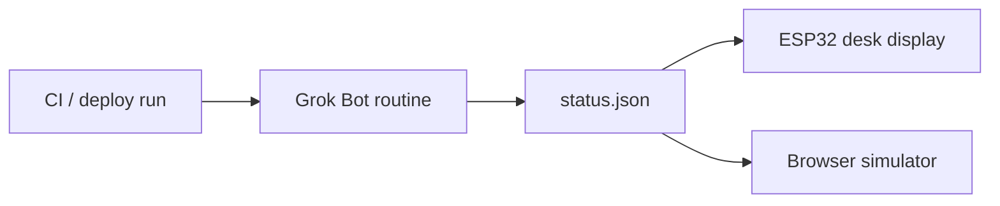

# grokdesk

A desk display for deploy status. One small screen shows four things: healthy (green), failed (red), a Grok Bot explanation, and resolved.

Three clients read the same JSON document:

- a browser simulator (this repo's `index.html`)
- a Waveshare ESP32-S3-Touch-LCD-4.3B firmware project (`firmware/`, PlatformIO)
- an earlier ESP32 + ILI9341 sketch (`firmware/grokdesk/grokdesk.ino`, also used in Wokwi)

The default simulator run is a **simulated demo**. Sample CI logs and a rule-based analyzer stand in for a real pipeline. Every demo label says **SIMULATED**. Nothing in demo mode calls an external API.

Live mode (`?live`) and the firmware both poll `status.json` instead.

## Architecture

A CI run finishes. A Grok Bot routine (or any other job you trust) writes `status.json`. The display polls that file and redraws.



This repo is the display and the status contract. It does not include the Grok Bot routine that would publish `status.json` from a real workflow. Drop a file in that shape and both clients render it.

## status.json

`status.json` at the repo root is the live document. GitHub Pages serves it next to the simulator.

```json
{
  "state": "healthy",
  "service": "checkout-api",
  "summary": "Rollout complete. 3/3 pods ready.",
  "fix": "",
  "run_url": "https://github.com/mingleiw/grokdesk/actions",
  "updated_at": "2026-10-13T09:13:40Z"
}
```

| Field | Meaning |
|---|---|
| `state` | One of `healthy`, `failed`, `analyzing`, `resolved`. |
| `service` | Service the run belongs to. |
| `summary` | One or two sentences. On `failed`, this is the Grok Bot explanation. |
| `fix` | Suggested fix. Often empty. Shown as `Suggest:` when set. |
| `run_url` | Link to the CI run. The simulator links it; the panel prints it on Serial. |
| `updated_at` | ISO-8601 timestamp. Clients redraw when it changes. |

How each `state` is drawn:

| `state` | Screen |
|---|---|
| `healthy` | Green. `DEPLOY HEALTHY`. Subtitle is `summary`, or `service` if summary is empty. |
| `failed` with empty `summary` and `fix` | Red `DEPLOY FAILED`. |
| `failed` with `summary` or `fix` | Grok Bot explanation: the summary, then `Suggest:` and `fix`. |
| `analyzing` | `Grok Bot analyzing…` plus `summary`. |
| `resolved` | Green again, marked fixed. Subtitle is `summary`. |
| any other value | `UNKNOWN STATE` / `UNKNOWN`. |

Examples for the other states live in `fixtures/`.

## GitHub Pages

The site is the repo root (`index.html`, `status.json`, the scripts, `fixtures/`). `.nojekyll` is present so Pages serves every file as-is.

Pages is not turned on by this repository. Enable it once:

**Settings → Pages → Build and deployment → Deploy from a branch → `main` → `/ (root)` → Save.**

After that:

- simulator: `https://mingleiw.github.io/grokdesk/`
- live simulator: `https://mingleiw.github.io/grokdesk/?live`
- status file: `https://mingleiw.github.io/grokdesk/status.json`
- 4.3B flasher: `https://mingleiw.github.io/grokdesk/flash/`

Pages sends `Cache-Control: max-age=600`, which made Safari keep showing the previous status. Live mode fetches `status.json?t=<Date.now()>` with `cache: 'no-store'` (and `Cache-Control: no-cache` on same-origin requests). The ILI9341 sketch appends `?t=<millis()>` to this Pages URL. The 4.3B firmware polls `raw.githubusercontent.com` instead (below) and does the same cache-bust.

The 4.3B flasher is served from this same site, at `/flash/`. Pages stays "Deploy from a branch" / `main` / `/ (root)`. The firmware workflow builds `flash/` and, on `main`, commits that directory so the simulator at `/` is unchanged.

## Run the simulator locally

```bash
python3 -m http.server 8765
# demo (SIMULATED):  http://localhost:8765/
# live, this repo's status.json:  http://localhost:8765/?live
# live, another document:         http://localhost:8765/?live=./fixtures/failed.json
```

Demo buttons: Healthy, Failed, Grok Bot analyze (analyzing, then the explanation), Resolved, and Auto demo (~12.5 s).

URL flags in demo mode: `?kiosk` hides the buttons, `?autostart` runs the auto demo, `?loop` repeats it. `?live` wins over `?autostart`.

Open the page through the local server or Pages. `file://` cannot fetch `status.json`.

## Live mode

`?live` with an empty value, `1`, or `true` polls same-origin `./status.json` every 5 seconds.

`?live=<url>` polls that URL instead. A relative URL is resolved against the page. A cross-origin URL has to send `Access-Control-Allow-Origin`, or the screen shows `STATUS UNREACHABLE`.

Live mode replaces the simulated log with the six status fields, swaps the yellow **SIMULATED** badge for a green **LIVE** badge, and hides the demo buttons. The demo is unchanged when `live` is absent.

The enclosure keeps a 4:3 aspect ratio and scales to the space it is given, so a phone in portrait or landscape shows the whole panel with the headline intact. Under 900px wide, live mode and `?kiosk` hide the log panel. Demo mode keeps the log, stacked under the device when the window is under 700px wide.

## Waveshare ESP32-S3-Touch-LCD-4.3B

The desk firmware is a PlatformIO project in `firmware/` (Arduino, ESP32-S3, Arduino_GFX on the RGB panel). The board is an ESP32-S3-WROOM-1-N16R8: 16MB flash, 8MB OPI PSRAM, 800×480 RGB LCD, GT911 touch on I2C (GPIO8 SDA, GPIO9 SCL, GPIO4 INT), and a CH422G expander. EXIO2 is the backlight and display enable (active high). EXIO3 resets the LCD. EXIO1 resets the touch controller. Timings match Waveshare's 4.3B demo: 16 MHz pixel clock, porches 8/4/8.

It polls `https://raw.githubusercontent.com/mingleiw/grokdesk/main/status.json` every 30 seconds over HTTPS. Each request adds `?t=<millis>` and `Cache-Control: no-cache`, because `raw.githubusercontent.com` caches the un-busted URL. The certificate is not checked (`setInsecure`); the file is public status.

| `state` | Panel |
|---|---|
| `healthy` | Green `#0d8a3a`. `DEPLOY HEALTHY`. Subtitle is `summary`, or `service` if summary is empty. |
| `failed` with `summary` or `fix` | Dark screen, red `DEPLOY FAILED`, `Grok Bot:` summary, `Suggest:` fix. |
| `failed` with both empty | Red `DEPLOY FAILED`. |
| `resolved` | Green `RESOLVED` plus `summary`. |
| `analyzing` | Dark screen, `Grok Bot analyzing...` plus `summary`. |
| anything else | `UNKNOWN STATE`. |
| no status yet, or Wi-Fi still connecting | `OFFLINE` / `CONNECTING`. |
| a later fetch fails | The last screen stays up, with an amber `STALE` mark and `no WiFi` when the radio is down. |

### Grok Bot

The status screens keep their text on the left. On the right, Grok Bot (a black orb with two slanted eyes) is animated at about 25 fps, with a movement for each state:

| Screen | Grok Bot |
|---|---|
| `healthy` | Bobs slowly, glances around, blinks. |
| `resolved` | Hops, with happy closed eyes. |
| `analyzing` | Eyes scan side to side; three dots pulse above it. |
| `failed` with explanation | Looks down at the explanation and shakes now and then. |
| `failed` without explanation | Wide eyes, frequent shakes. |
| unknown state | Looks up from side to side under a `?`. |
| `OFFLINE` | Eyes closed, `z` drifting up. |

The sprite is drawn off-screen in PSRAM (`firmware/src/bot.cpp`) and copied into the panel's frame each frame, so it does not flicker. It pauses while a status fetch is in flight (usually about a second every 30 s). The Wi-Fi setup and `CONNECTING` screens have no bot.

The top bar is the UTC clock (from NTP), `GROKDESK`, and the Wi-Fi mark. The footer is `grokdesk` and `upd HH:MM` from `updated_at`. `run_url` is printed at 115200 and, on the failed explanation, as a short line.

### Flash from the browser

Open `https://mingleiw.github.io/grokdesk/flash/` in **Chrome or Edge** on a computer (WebSerial). Plug the board in with a **USB-C data cable**. Click **Install GrokDesk** and choose the USB serial port.

If the port does not show up, hold **BOOT**, tap **RESET** or plug the cable in, then release BOOT. The ROM download mode uses the USB-Serial/JTAG pins on that connector. After a successful flash, press **RESET** if the screen stays blank.

The image is one merged `.bin` (bootloader at `0x0`, partition table at `0x8000`, app at `0x10000`). Writing it fills the NVS gap with `0xFF`, so saved Wi-Fi is cleared and the setup portal comes back. The button also offers a full erase on a chip that has never run this image.

`firmware/build.sh` is what CI runs (`pio run`, then `esptool merge_bin`).

### Wi-Fi

On first boot the panel shows **WI-FI SETUP** and the board opens an access point named `GrokDesk-Setup` (open, captive portal). Join it from a phone or laptop and submit the desk network. WiFiManager stores the credentials in NVS, so the next boot reconnects without the portal.

**Hold a finger on the screen for 3 seconds** to erase those credentials and reboot into the portal. A bar labeled "Hold to reset Wi-Fi" fills while you hold. Releasing early cancels.

### Troubleshooting

| What you see | What to try |
|---|---|
| Install button says the browser is unsupported | Chrome or Edge. Firefox and Safari cannot use WebSerial. |
| No serial port | USB-C data cable (not charge-only). Hold BOOT, tap RESET, release BOOT, then try again. |
| Flash succeeds, screen stays black | Press RESET. Confirm the panel flex is seated. Serial at 115200 should print `grokdesk 4.3B` and a PSRAM size of about 8MB. `PSRAM missing` means the image was not the 4.3B build (`qio_opi`). |
| Backlight on, colors wrong or the picture drifts | The porch and clock polarity are the Waveshare 4.3B demo values. A different panel revision (some boards are 1024×600) will not match this image. |
| Stuck on WI-FI SETUP | The portal has no password. If the phone never opens a page, browse to `192.168.4.1`. |
| OFFLINE / STALE after Wi-Fi is up | The board cannot fetch `status.json`. Serial prints `GET ... -> <code>`. `raw.githubusercontent.com` must be reachable from that network. The amber STALE mark means the pixels are the previous good document, not a live one. |
| Clock stays `--:--` | NTP (`pool.ntp.org`) did not answer. Status text still updates. The clock is UTC. |
| Touch does not reset Wi-Fi | Serial should print `GT911 at 0x5d id 911`. If the id line is missing, the expander reset did not reach the controller. Hold closer to the middle of the glass for the full 3 seconds. |

## Earlier ILI9341 sketch

The no-solder Wokwi / bench option is an **ESP32-2432S028**, sold as the "Cheap Yellow Display": ESP32 and a 2.8" ILI9341 on one board, powered over USB.

Wiring, the CYD build flags, the status-to-pixels table, and Wokwi are in [`firmware/hardware.md`](firmware/hardware.md).

Short version:

```bash
# libraries, once: ArduinoJson 7.x and TFT_eSPI
arduino-cli lib install "ArduinoJson" "TFT_eSPI"
firmware/compile.sh
```

`firmware/grokdesk/` is also a Wokwi project (`diagram.json`, `wokwi.toml`, ESP32 DevKitC + ILI9341). On wokwi.com, use the sketch folder as-is (`libraries.txt` and `build_opt.h`). Wi-Fi defaults to the simulator network `Wokwi-GUEST`. For a real board, copy `secrets.h.example` to `secrets.h` and set the SSID, password, and URL.

## Reproduce the demo and the headless test

```bash
python3 -m venv .venv && . .venv/bin/activate
pip install playwright
python test_and_record.py
```

The script serves the repo, drives headless Chrome through every demo button and the auto-demo sequence, then through live mode (healthy, failed explanation, analyzing, resolved, unknown state, missing file). It writes `screenshots/` and, when ffmpeg is available, `demo.mp4` from the kiosk auto-demo.

`demo.mp4` in the repo is that recording. `.venv/`, `__pycache__/`, Playwright's `.rec/`, the Arduino `firmware/grokdesk/build/` directory, and PlatformIO's `.pio/` directory are gitignored.
