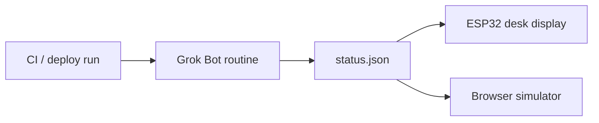

# grokdesk

A desk display for deploy status. One small screen shows four things: healthy (green), failed (red), a Grok Bot explanation, and resolved.

Two clients read the same JSON document:

- a browser simulator (this repo's `index.html`)
- an ESP32 + ILI9341 firmware sketch (`firmware/grokdesk/grokdesk.ino`)

The default simulator run is a **simulated demo**. Sample CI logs and a rule-based analyzer stand in for a real pipeline. Every demo label says **SIMULATED**. Nothing in demo mode calls an external API.

Live mode (`?live`) and the firmware both poll `status.json` instead.

## Architecture

A CI run finishes. A Grok Bot routine (or any other job you trust) writes `status.json`. The display polls that file and redraws.



This repo is the display and the status contract. It does not include the Grok Bot routine that would publish `status.json` from a real workflow. Drop a file in that shape and both clients render it.

## status.json

`status.json` at the repo root is the live document. GitHub Pages serves it next to the simulator.

```json
{
  "state": "healthy",
  "service": "checkout-api",
  "summary": "Rollout complete. 3/3 pods ready.",
  "fix": "",
  "run_url": "https://github.com/mingleiw/grokdesk/actions",
  "updated_at": "2026-10-13T09:13:40Z"
}
```

| Field | Meaning |
|---|---|
| `state` | One of `healthy`, `failed`, `analyzing`, `resolved`. |
| `service` | Service the run belongs to. |
| `summary` | One or two sentences. On `failed`, this is the Grok Bot explanation. |
| `fix` | Suggested fix. Often empty. Shown as `Suggest:` when set. |
| `run_url` | Link to the CI run. The simulator links it; the panel prints it on Serial. |
| `updated_at` | ISO-8601 timestamp. Clients redraw when it changes. |

How each `state` is drawn:

| `state` | Screen |
|---|---|
| `healthy` | Green. `DEPLOY HEALTHY`. Subtitle is `summary`, or `service` if summary is empty. |
| `failed` with empty `summary` and `fix` | Red `DEPLOY FAILED`. |
| `failed` with `summary` or `fix` | Grok Bot explanation: the summary, then `Suggest:` and `fix`. |
| `analyzing` | `Grok Bot analyzing…` plus `summary`. |
| `resolved` | Green again, marked fixed. Subtitle is `summary`. |
| any other value | `UNKNOWN STATE` / `UNKNOWN`. |

Examples for the other states live in `fixtures/`.

## GitHub Pages

The site is the repo root (`index.html`, `status.json`, the scripts, `fixtures/`). `.nojekyll` is present so Pages serves every file as-is.

Pages is not turned on by this repository. Enable it once:

**Settings → Pages → Build and deployment → Deploy from a branch → `main` → `/ (root)` → Save.**

After that:

- simulator: `https://mingleiw.github.io/grokdesk/`
- live simulator: `https://mingleiw.github.io/grokdesk/?live`
- status file: `https://mingleiw.github.io/grokdesk/status.json`

The firmware's default URL is that status file. Pages caches static files; both clients append a cache-busting query string so a new `updated_at` shows up on the next poll.

## Run the simulator locally

```bash
python3 -m http.server 8765
# demo (SIMULATED):  http://localhost:8765/
# live, this repo's status.json:  http://localhost:8765/?live
# live, another document:         http://localhost:8765/?live=./fixtures/failed.json
```

Demo buttons: Healthy, Failed, Grok Bot analyze (analyzing, then the explanation), Resolved, and Auto demo (~12.5 s).

URL flags in demo mode: `?kiosk` hides the buttons, `?autostart` runs the auto demo, `?loop` repeats it. `?live` wins over `?autostart`.

Open the page through the local server or Pages. `file://` cannot fetch `status.json`.

## Live mode

`?live` with an empty value, `1`, or `true` polls same-origin `./status.json` every 5 seconds.

`?live=<url>` polls that URL instead. A relative URL is resolved against the page. A cross-origin URL has to send `Access-Control-Allow-Origin`, or the screen shows `STATUS UNREACHABLE`.

Live mode replaces the simulated log with the six status fields, swaps the yellow **SIMULATED** badge for a green **LIVE** badge, and hides the demo buttons. The demo is unchanged when `live` is absent.

## Hardware

The no-solder option is an **ESP32-2432S028**, sold as the "Cheap Yellow Display": ESP32 and a 2.8" ILI9341 on one board, powered over USB.

Wiring, the CYD build flags, the status-to-pixels table, and Wokwi are in [`firmware/hardware.md`](firmware/hardware.md).

Short version:

```bash
# libraries, once: ArduinoJson 7.x and TFT_eSPI
arduino-cli lib install "ArduinoJson" "TFT_eSPI"
firmware/compile.sh
```

`firmware/grokdesk/` is also a Wokwi project (`diagram.json`, `wokwi.toml`, ESP32 DevKitC + ILI9341). On wokwi.com, use the sketch folder as-is (`libraries.txt` and `build_opt.h`). Wi-Fi defaults to the simulator network `Wokwi-GUEST`. For a real board, copy `secrets.h.example` to `secrets.h` and set the SSID, password, and URL.

## Reproduce the demo and the headless test

```bash
python3 -m venv .venv && . .venv/bin/activate
pip install playwright
python test_and_record.py
```

The script serves the repo, drives headless Chrome through every demo button and the auto-demo sequence, then through live mode (healthy, failed explanation, analyzing, resolved, unknown state, missing file). It writes `screenshots/` and, when ffmpeg is available, `demo.mp4` from the kiosk auto-demo.

`demo.mp4` in the repo is that recording. `.venv/`, `__pycache__/`, Playwright's `.rec/`, and the Arduino `firmware/grokdesk/build/` directory are gitignored.
